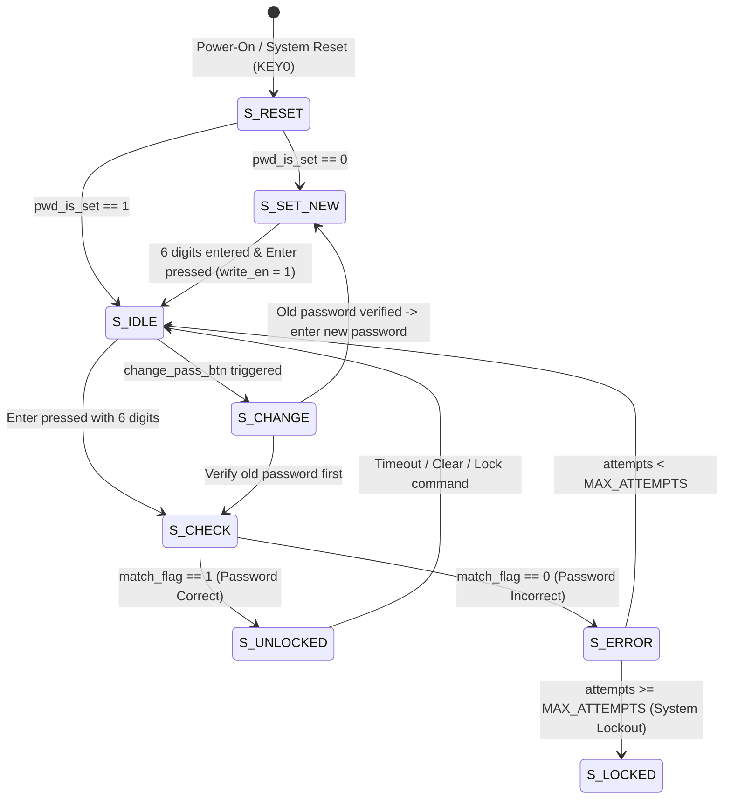

# CE213: Keyless Electronic Lock System on FPGA (Altera DE2)

An end-to-end digital system implementation of an **Electronic Keyless Lock System** modeled in Verilog HDL, targeted for the **Altera Cyclone II FPGA (EP2C35F672C6)** on the **Terasic DE2 Development Board**.

The system provides complete access control management, including 6-digit PIN entry, password comparison, multi-step passcode modification, lockout on consecutive failed attempts, matrix keypad debouncing, and dual-mode character LCD visualization (Parallel HD44780 & I2C via PCF8574).

---

## 📌 Key Features

- **Robust Access Control & State Management:**
  - 6-digit numeric passcodes (24-bit packed binary/hex representation).
  - Multi-state finite state machine (FSM) managing system initialization, password provisioning, verification, door unlatch, alarm/lockout, and password modification.
  - Non-volatile-ready register-based `Password_Memory` with write-enable gating and initialization status flags (`pwd_is_set`).
  - Consecutive failed-attempt tracking with 5-stage error visualization on red LEDs (`LEDR[4:0]`) and system freeze on security violations.
- **Dual Input Interface Support:**
  - **4x4 Matrix Keypad Interface (`Keypad_Scanner`):** Time-multiplexed row scanning (1 kHz scan rate generated from 50 MHz system clock) with hardware debouncing and one-hot row activation.
  - **On-board Pushbuttons & Toggle Switches (`Switch_Input`):** On-board fallback input enabling complete testing directly on the DE2 board using `SW[3:0]` for digit entry, `SW[9]` for passcode masking toggle, and `KEY[3:1]` for functional controls (Enter, Backspace, Clear).
- **Dual LCD Display Engines:**
  - **I2C Master LCD Driver (`LCD_Driver_I2C` & `I2C_Master`):** Transmits 16x2 ASCII messages over a 2-wire open-drain I2C bus at 100 kHz standard mode, directly compatible with PCF8574 backpack modules.
  - **Parallel HD44780 Controller (`LCD_Driver`):** 8-bit parallel interface utilizing a dual-clock architecture (50 MHz synchronization and 1 kHz LCD command sequence timing) to eliminate screen flickering.
  - **Privacy Mode / Masking:** Support for toggling between hidden asterisks (`******`) and plain digits.

---

## 🏗️ Architecture & Block Diagram

```text
               +-------------------------------------------------------------+
               |                  Digital_Lock_Top (FPGA)                    |
               |                                                             |
 [4x4 Keypad]  |   +------------------+             +--------------------+   |
 (or SW/KEY) ----->| Keypad_Scanner / | key_code    |                    |   |
               |   |   Switch_Input   |------------>|    Input_Buffer    |   |
               |   +------------------+ key_valid   |   (6-digit Shift)  |   |
               |                                    +--------------------+   |
               |                                              |              |
               |                                         buffer_data         |
               |                                         (24-bit)            |
               |                                              v              |
               |      +------------------+              +------------+       |
               |      | Password_Memory  |  stored_pwd  |    Code    |       |
               |      |  (24-bit Reg)    |------------->|  Checker   |       |
               |      +------------------+              +------------+       |
               |               ^                              | match_flag   |
               |       write_en|                              v              |
               |      +----------------------------------------------+       |
               |      |                  Main_FSM                    |       |
               |      |  - S_RESET        - S_CHECK       - S_ERROR  |       |
               |      |  - S_SET_NEW      - S_UNLOCKED    - S_CHANGE |       |
               |      |  - S_IDLE                                    |       |
               |      +----------------------------------------------+       |
               |            |                       |          |             |
               |       lcd_line1/2             unlock_led  error_leds        |
               |            v                       |          |             |
               |   +------------------+             |          |             |
               |   |  LCD_Driver_I2C  |             |          |             |
               |   |   (100kHz I2C)   |             |          |             |
               |   +------------------+             |          |             |
               +------------|-----------------------|----------|-------------+
                            |                       |          |
                            v                       v          v
                       [I2C 16x2 LCD]            [LEDG0]  [LEDR4..0]
                        (SDA / SCL)             (Unlocked) (Attempts)
```

---

## 🔄 Main Controller FSM



### State Descriptions:
1. **`S_RESET` (000):** System reset and hardware initialization. Checks if a password already exists in memory.
2. **`S_SET_NEW` (001):** Active when no password has been provisioned. Prompts `"SET INITIAL PWD"` and writes the new 6-digit PIN into `Password_Memory`.
3. **`S_IDLE` (010):** Normal waiting state displaying `"ENTER PASSWORD: "` and accepting user keystrokes into `Input_Buffer`.
4. **`S_CHECK` (011):** Asserts `en_compare` to evaluate `buffer_data == stored_password` via single-cycle comparator `Code_Checker`.
5. **`S_UNLOCKED` (100):** Asserts `unlock_led` (LEDG0), updates LCD to `"DOOR IS OPENED"`, and activates unlocking timer.
6. **`S_ERROR` (101):** Increments failed-attempt register, illuminates corresponding red error LEDs (`LEDR[4:0]`), and flashes `"WRONG PASSWORD!"`. If consecutive errors exceed limit, triggers `"SYSTEM LOCKED!"`.
7. **`S_CHANGE` (110):** Initiates password change sequence requiring verification of old passcode before transitioning to `S_SET_NEW`.

---

## 📂 Repository Structure

```text
ce213-keyless-lock-system/
├── DO_AN.qpf                  # Quartus Prime Project File
├── DO_AN.qsf                  # Quartus Settings File (DE2 Pin Assignments)
├── .gitignore                 # EDA & Build artifact exclusions
├── README.md                  # Project documentation
│
├── rtl/                       # Synthesizable Verilog RTL source files
│   ├── Common_Params.v        # Keycode definitions and ASCII string constants
│   ├── Digital_Lock_Top.v     # Top-level entity (DE2 + I2C LCD + Switch Input)
│   ├── Digital_Lock_Top2.v    # Top-level entity variant (Parallel HD44780 LCD)
│   ├── Top_Test_Keypad.v      # Hardware test top for physical 4x4 matrix keypad
│   ├── Main_FSM.v             # Master control Finite State Machine
│   ├── Keypad_Scanner.v       # 4x4 Keypad matrix scanner with 1ms debounce
│   ├── Input_Buffer.v         # 6-digit shift register & key event processor
│   ├── Code_Checker.v         # 24-bit comparator for passcode validation
│   ├── Password_Memory.v      # Passcode storage register with write-enable logic
│   ├── Switch_Input.v         # On-board switch & button input converter
│   ├── LCD_Driver_I2C.v       # High-level I2C LCD 16x2 controller
│   ├── I2C_Master.v           # Low-level 100 kHz I2C bus controller
│   └── LCD_Driver.v           # 8-bit parallel HD44780 LCD controller
│
├── tb/                        # Simulation testbenches
│   ├── Code_Checker_tb.v      # Self-checking testbench for passcode comparator
│   ├── Keypad_Scanner_tb.v    # Self-checking testbench for matrix keypad scanner
│   └── tb_Digital_Lock_Top.v  # Full top-level system simulation testbench
│
└── docs/                      # Technical documentation & project assets
    ├── Keypad.docx            # Detailed keypad design specifications
    └── hardware_demo.jpg      # Hardware demonstration on Altera DE2 board
```

---

## 🎛️ Pinout & Hardware Mapping (Altera DE2)

| Peripheral | Port Name | DE2 Pin | Description |
| :--- | :--- | :--- | :--- |
| **Clock** | `CLOCK_50` | `PIN_N2` | 50 MHz Master Oscillator |
| **Reset** | `KEY[0]` | `PIN_G26` | Active-low master asynchronous reset |
| **Functional Keys** | `KEY[1]` | `PIN_N23` | Digit Enter / Confirm (in switch mode) |
| | `KEY[2]` | `PIN_P23` | Backspace (delete last entered digit) |
| | `KEY[3]` | `PIN_W26` | Clear (reset current input buffer) |
| **Toggle Switches** | `SW[3:0]` | `PIN_N25, PIN_N26, PIN_P25, PIN_AE14` | Binary digit input (0000 = 0 to 1001 = 9) |
| | `SW[7]` | `PIN_AA24` | Change Password trigger |
| | `SW[8]` | `PIN_AB24` | Mode toggle (Digit Entry vs. Submit) |
| | `SW[9]` | `PIN_AC24` | Passcode masking toggle (Plain text / `******`) |
| **I2C LCD** | `I2C_SDA` | Expansion GPIO | Open-drain I2C serial data line |
| | `I2C_SCL` | Expansion GPIO | Open-drain I2C serial clock line |
| **Status LEDs** | `LEDG0` | `PIN_AE22` | Green LED: Access granted (Door Unlocked) |
| | `LEDR[4:0]` | `PIN_AE23, PIN_AF23, ...` | Red LEDs: Consecutive failed attempt counter |

---

## 🧪 Simulation & Verification

### Running Unit Testbenches in ModelSim:

1. **Password Comparator Test:**
   ```bash
   vlib work
   vlog rtl/Code_Checker.v tb/Code_Checker_tb.v
   vsim -c -do "run -all; quit" Code_Checker_tb
   ```

2. **Matrix Keypad Scanner Test:**
   ```bash
   vlog rtl/Common_Params.v rtl/Keypad_Scanner.v tb/Keypad_Scanner_tb.v
   vsim -c -do "run -all; quit" Keypad_Scanner_tb
   ```

3. **Top-Level System Test:**
   ```bash
   vlog +incdir+rtl rtl/*.v tb/tb_Digital_Lock_Top.v
   vsim -c -do "run -all; quit" tb_Digital_Lock_Top
   ```

---

## 🛠️ Synthesis & Programming (Intel Quartus Prime)

1. Open Intel Quartus Prime (recommended: **Quartus II 13.0sp1 Web Edition** for Cyclone II support).
2. Open project file `DO_AN.qpf`.
3. Check pin assignments under **Assignments > Assignment Editor** (configured via `DO_AN.qsf`).
4. Click **Processing > Start Compilation** (`Ctrl + L`).
5. Connect the Altera DE2 board via USB-Blaster cable and power on.
6. Open **Tools > Programmer**, select `output_files/Digital_Lock_Top.sof`, and click **Start** to configure the FPGA SRAM.

---

## 👥 Authors & Acknowledgments

- **Course:** CE213 - Digital System Design (Thiết kế hệ thống số)
- **Institution:** University of Information Technology (UIT - VNU-HCM)
- **Contributors:** 
  - Nghia ([@aresnghia](https://github.com/aresnghia))
  - Khoi
